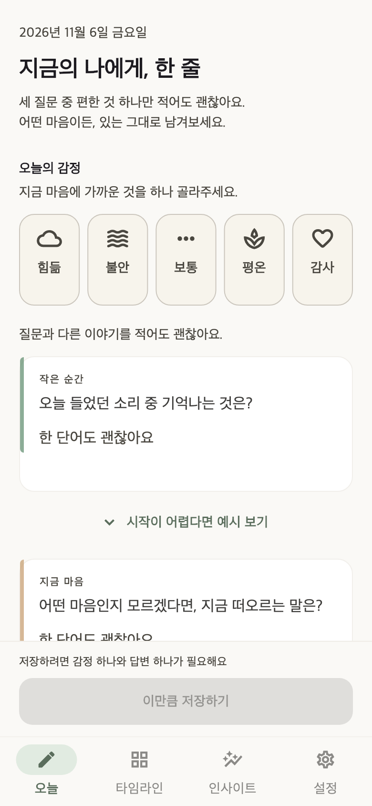
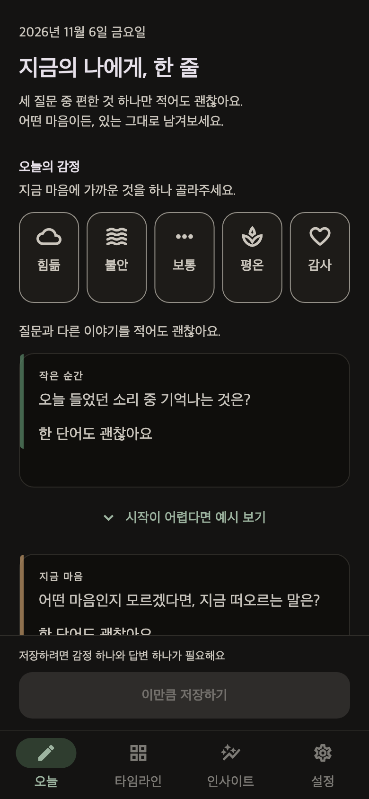
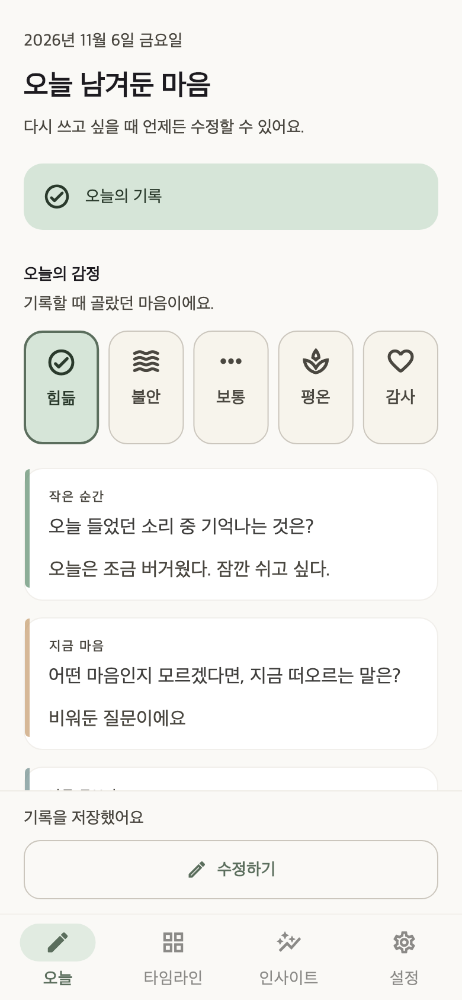

# 3Lines 부담을 낮추는 UI/UX 개선 결과

2026-11-06. [조사 근거와 설계](../specs/2026-11-06-supportive-journaling-design.md)에 따라 오늘 기록 화면과 첫 안내를 개선했다.

## 반영한 변경

- 쓰기를 먼저 보여주고, 연속 기록과 기념 배너, 과거 기록과 감정 흐름은 아래에서 직접 펼칠 때만 표시한다.
- 세 질문 중 하나를 선택해 써도 된다고 안내한다. 질문은 작은 순간, 지금 마음, 필요한 돌봄으로 바꾸고 감사나 극복을 전제하는 예시를 없앴다.
- 예시는 접힌 상태로 시작한다. 사용자 지정 질문에는 기본 예시를 붙이지 않으며, 기존 답변 뒤에 예시를 추가할 때의 되돌리기는 유지한다.
- 감정 선택은 차분한 기호, 읽기 쉬운 이름, 선택 체크와 테두리를 사용한다. 작은 화면이나 큰 글자에서는 자동으로 줄을 나눈다.
- 저장 버튼의 작성량 분수와 진행 링, 자동 전면 축하 화면을 없앴다. ‘이만큼 저장하기’로 저장하고, 하단에 ‘기록을 저장했어요’를 계속 보여준다.
- 저장 오류는 버튼 위에서 안내한다. 입력과 선택 감정을 보존하고 다시 저장할 수 있다. 성공 후 과거 실패 알림이 남지 않는다.
- 키보드의 ‘다음’은 예시 버튼을 건너뛰고 다음 답변칸으로 이동한다. 예시 버튼 자체는 키보드로 접근할 수 있다.
- 첫 안내의 시간 제한처럼 느껴질 수 있는 문구를 바꿨고, 큰 글자에서는 내용을 스크롤할 수 있다.

감정 하나와 답변 하나가 필요한 기존 저장 조건, DB 스키마, 사용자 질문 설정과 저장 당시 질문 스냅샷은 유지했다. 저장 전 앱 종료를 견디는 초안 보존 기능은 추가하지 않았다.

## 검증 결과

| 검증 | 이 세션에서 확인한 결과 |
|---|---|
| 전체 `flutter test --reporter expanded` | 439개 통과 |
| 마지막 기호 수정과 대비 테스트 추가 후 관련 테스트 | 20개 통과. Today 레이아웃, 감정 선택, 전체 앱 저장 흐름 |
| `flutter analyze --no-pub` | No issues found |
| 변경한 Dart 파일 16개 포맷 검사 | 변경 필요 없음 |
| `git diff --check` | 오류 없음 |
| 실제 앱 위젯 렌더링 | 밝은 모드, 어두운 모드, 저장 상태 생성. 렌더링 하네스 2개 테스트 통과 |

구체적으로 320×568과 740×360 화면에서 200% 글자를 확인했다. 320×568 전체 앱에서는 200% 글자와 키보드 하단 여백 180px를 함께 적용하고 실제 메모리 DB 저장까지 검증했다. 일반 텍스트와 감정 선택 상태에 사용하는 5개 색상 조합은 밝은 테마와 어두운 테마 모두 4.5:1 이상이다. 감정 버튼의 Android 48px 터치 영역과 접근성 이름/동작도 검사했다. 이는 앱 전체의 WCAG 인증이나 모든 보조 기술 검증을 뜻하지 않는다.

읽기 전용 교차 검토에서 발견한 저장 확인의 화면 밖 노출, 키보드 다음 이동, 첫 안내의 큰 글자 넘침은 각각 실패 테스트로 재현한 뒤 수정했다. 저장 성공 후 이전 실패 알림이 남는 문제도 재현해 수정했다. 질문 교체 때문에 실패한 기존 테스트 기대값은 새 기본 질문으로 갱신했다.

## 화면

아래 이미지는 실제 `ThreeLinesApp` 위젯을 390×844 크기로 렌더링한 결과다. 메모리 DB와 예시 기록을 사용했으며 실제 사용자 기록이 아니다. 테스트 엔진에서 한글을 표시하기 위해 Apple SD Gothic Neo와 Material Icons를 명시적으로 로드했다. 실기기 캡처가 아니므로 플랫폼별 글꼴과 시스템 영역에는 차이가 있을 수 있다.

| 쓰기, 밝은 모드 | 쓰기, 어두운 모드 | 저장한 기록 |
|---|---|---|
|  |  |  |

## 남은 검증과 작업 경계

- 실제 iOS/Android의 VoiceOver/TalkBack, 시스템 키보드와 글꼴, 터치 사용성은 별도 실기기 확인이 필요하다.
- 취약한 상황에 있는 사용자와 사용성 세션을 수행하지 않았다. 따뜻함과 부담 감소는 이번 설계의 목표이며 검증된 임상적 효과가 아니다.
- Timeline/Insights의 분석 화면과 알림 정책은 이번 구현 범위에 포함하지 않았다.
- 커밋, 배포, 스토어 릴리스는 하지 않았다. 시작 시 존재한 아이콘과 알림 작업, 작업 중 별도로 변경된 분석 설정을 보존했다. Flutter 도구가 갱신한 플랫폼 플러그인 등록 파일은 UI 구현과 구분해야 한다.
